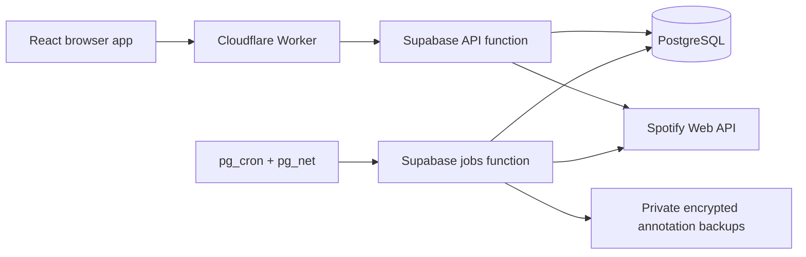

# Spotify Plus

**Your Liked Songs, in your own words. Playlists for the moment.**

[](https://github.com/CarterKFalkenberg/spotify-plus/actions/workflows/verify.yml)

Spotify Plus is a personal web app for tagging Spotify Liked Songs and turning
those tags into real playlists that clean themselves up. Bulk-tag a backlog at
your desk, keep up with new arrivals using the keyboard, then build a playlist
from your phone before heading out.

Built for **one Spotify account**, with Spotify as the only login. Tags are yours;
listening stays in Spotify. The app never likes or unlikes songs.

[How it works](#how-it-works) · [Development](#development) ·
[Self-hosting](#self-hosting) · [Architecture](#architecture) ·
[Documentation](#documentation)

## Why this exists

A large Liked Songs library remembers what you saved, but not why you saved it.
Personal tags make room for moods, situations, energy, and whatever shorthand
makes sense to you. You can organize a few artists at a time without needing to
finish the entire library before playlists become useful.

The other half is avoiding playlist clutter: choose a retention window when you
create a playlist, extend it if you still want it, or pin it to keep it.

## How it works

1. **Connect Spotify.** Import starts automatically and continues with the browser
   closed. Browse and tag while songs arrive; creation unlocks after the first
   complete, verified sync.
2. **Tag your way.** Start with your biggest artist groups, bulk-edit a filtered
   selection, or use the focused queue for a few songs at a time. Changes save
   immediately and support undo.
3. **Build a query.** Combine tags with **All of**, **Any of**, and **None of**.
   Preview the matching songs, count, and duration from the cached library without
   making Spotify requests.
4. **Create and listen.** Name the playlist, pick a week, a month, three months, or
   Pinned, then open it in Spotify. The default is one calendar month.
5. **Keep it or let it go.** Extend, pin, regenerate, or remove it now. Scheduled
   cleanup removes expired app-managed playlists from Your Library.

For example, using made-up personal tags:

| Query bucket | Tags                  |
| ------------ | --------------------- |
| All of       | `chill`               |
| Any of       | `driving`, `roadtrip` |
| None of      | `sad`                 |

This selects `chill AND (driving OR roadtrip) AND NOT sad`. Tags are flat,
free-form strings; emoji, accents, and personal prefix conventions are welcome.

### Tagging without the backlog guilt

- **Library browser:** search, sort, filter untagged songs, use artist/album/decade
  facets, group rows, and select all matching songs for bulk changes.
- **Focused queue:** persistent tag input, autocomplete, quick slots on **1–9**,
  next/previous, skip and requeue, undo, and an Open in Spotify action. Numbers
  apply quick tags only when the input is empty; modified letter shortcuts keep
  ordinary typing safe. The in-app help lists the shortcuts.
- **Vocabulary management:** usage counts, rename, merge, delete, and unused tags.
  Stable tag identities keep stored queries intact through renames and merges.
- **Phone triage:** new-arrival cards open a song sheet with quick tags, input,
  and swipe or button navigation. Desktop handles bulk work; phones prioritize
  making playlists and clearing new arrivals.

### Playlist behavior worth knowing

A generated playlist is a **snapshot**, not a live filter. Later tag changes do
not alter it. **Regenerate** reruns its saved query in the same Spotify playlist,
resets expiry, and preserves its current Spotify name and notes outside the
app-managed description block. Manual track edits in Spotify are overwritten by
Regenerate.

Expiry uses calendar dates in `America/New_York`. A playlist remains valid through
its displayed date and becomes eligible for scheduled cleanup the following day.
Pinning disables expiry; unpinning starts a fresh selected retention window.

Spotify has no permanent playlist-delete API. Here, removal means removing an
app-managed playlist from **Your Library**; its URL or other followers may remain.
Publication settings also do not restrict access by link. See
[Spotify's playlist semantics](https://developer.spotify.com/documentation/web-api/concepts/playlists).

## Project status

The application implements the connect → sync → tag → generate → expire loop,
with desktop and mobile interfaces and synthetic automated coverage. It is a
personal project intended for a single configured owner, rather than a public
multi-user service.

**Human product acceptance is still pending:** the actual phone flow in under a
minute, familiar-song tagging at roughly 3–5 seconds per song, and actual playlist
hiding from the Spotify profile and search. The app requests noncollaborative,
unpublished playlists, but observed Spotify publication readbacks have contradicted
successful write acknowledgements. A successful request does not establish that a
playlist is hidden. The [accepted publication decision](docs/DECISIONS.md#playlist-publication-requirement--october-11-2026)
and [acceptance issue](https://github.com/CarterKFalkenberg/spotify-plus/issues/13)
track that distinction.

## Architecture



| Layer                            | Responsibility                                                                          |
| -------------------------------- | --------------------------------------------------------------------------------------- |
| React, Vite, React Router        | Tagging workspace, query preview, playlist management                                   |
| Cloudflare Workers Static Assets | Frontend hosting and a thin same-origin API/OAuth proxy                                 |
| Supabase Edge Functions · Deno   | Spotify PKCE login, owner sessions, product API, bounded job execution                  |
| Supabase PostgreSQL              | Annotations, cached membership, query evaluation, transactional mutations, durable jobs |
| `pg_cron`, `pg_net`, Vault       | Authenticated scheduled work that continues without an open browser                     |
| Private Supabase Storage         | Three retained daily encrypted annotation backups                                       |

Jobs use transactional leases, retry timestamps, and checkpoints. Timed-out Spotify
writes are reconciled against remote state before retrying; an ambiguous response
is not treated as success. Library sync compares consecutive complete membership
walks before reconciling removals because Spotify offset pagination is not a
snapshot.

The [architecture guide](docs/architecture/README.md) includes a standalone
handbook, an interactive request walkthrough, and 17 diagrams. It documents a
pinned implementation snapshot; current source and accepted decisions remain the
authority.

## Development

Use **Node 24** (pinned in [.node-version](.node-version)), **Deno 2.9.7**,
**Supabase CLI 2.120.0**, and Docker for database checks. Dependency versions are
locked in `package-lock.json`.

```sh
git clone https://github.com/CarterKFalkenberg/spotify-plus.git
cd spotify-plus
npm ci
npx playwright install chromium
npm run dev
```

Vite serves the frontend at `http://127.0.0.1:5173`. **This is a frontend dev server:**
it does not start the authenticated API, OAuth proxy, or scheduled backend. The
Playwright suite supplies synthetic API responses for desktop and mobile flows;
it is the account-free way to exercise the interface. A connected installation
requires the [self-hosting setup](#self-hosting).

### Checks

| Command                           | What it verifies                                                                            |
| --------------------------------- | ------------------------------------------------------------------------------------------- |
| `npm run typecheck`               | Frontend and proxy TypeScript                                                               |
| `npm test`                        | Vitest behavior and contract tests                                                          |
| `npm run test:browser`            | Synthetic desktop/mobile Playwright flows; starts its own Vite server on port 4173          |
| `npm run build`                   | Production frontend bundle                                                                  |
| `sh scripts/check`                | Full setup, formatting, type, unit, browser, Deno, and PostgreSQL checks                    |
| `node scripts/check-supabase.mjs` | Disposable local Supabase migrations, real REST boundaries, and authenticated cron delivery |

The full checks need Docker running. The disposable Supabase harness uses ports
**61021–61030**; coordinate with other local runs. CI runs the full check and that
harness using synthetic data, without production credentials. Linux browser setup
may require `npx playwright install --with-deps chromium`.

Live stage verification is a separate operator workflow. It requires configured
credentials, scoped authorizations, fresh provider observations, and an exact
deployed revision. Follow [LIVE-VERIFICATION.md](scripts/LIVE-VERIFICATION.md);
stored receipts or synthetic tests do not prove current production health.

### Repository map

```text
app/                  React interface
proxy/                Cloudflare same-origin proxy
supabase/functions/   API, jobs, Spotify adapter, and shared domain code
supabase/migrations/  Versioned schema and transactional SQL functions
supabase/tests/       Database and REST integration checks
tests/                Tooling, frontend, proxy, and browser tests
scripts/              Checks, deployment, live verification, and recovery tools
docs/                 Product decisions, contracts, setup, and architecture
```

## Self-hosting

Read the [complete setup checklist](docs/SETUP.md) before configuring a connected
instance. It covers accounts, callbacks, owner binding, credentials, deployment,
and recovery. The intended stack is **Supabase Free + Cloudflare Workers Free**,
with a free `workers.dev` URL and a **$0/month hosting ceiling**. Your existing
Spotify Premium subscription is separate from hosting.

You will need a Spotify developer app and an allowlisted owner account. Spotify's
[development-mode requirements](https://developer.spotify.com/documentation/web-api/concepts/quota-modes)
include Premium for the app owner. This application's own authorization still
permits exactly one bound owner. Register the exact HTTPS hosted callback and the
setup callback `http://127.0.0.1:3000/auth/spotify/callback`; Spotify does not accept
`localhost` as a [redirect hostname](https://developer.spotify.com/documentation/web-api/concepts/redirect_uri).

`node scripts/init-local.mjs` initializes ignored local configuration and keys
without overwriting existing files. Follow setup to supply the remaining values;
never commit credentials. New development worktrees share `.local` through a
symlink. Management credentials stay in operator tooling, while Spotify tokens
remain encrypted on the backend and out of browser storage.

Free hosting has operational limits: Supabase may pause an inactive project,
quotas can interrupt work, and cleanup catches up after recovery. Cron is not an
uptime guarantee. Verify actual Free plans and usage before deployment; a quota
failure is a reason to reduce work or stop, never permission to upgrade. See
[hosting trade-offs](docs/HOSTING.md).

## Data and safety

- **Spotify owns library membership; the app owns annotations.** Unliking a song
  removes it from active results without deleting its tags. Removed-track metadata
  expires after 90 days; a minimal keyed identifier lets re-liking restore tags.
- **Liked Songs are read-only.** The adapter rejects saved-library writes except
  removal of validated app-managed playlist URIs. No profile scopes, playback
  integration, audio-feature dependency, or AI features are used.
- **Spotify content stays out of AI workflows.** Development uses synthetic
  fixtures; real checks return only counts, statuses, and schema booleans. Do not
  upload real library metadata, artwork, response dumps, or screenshots to models.
- **Disconnect is explicit.** It stops jobs and deletes app data, credentials, and
  app-controlled annotation backups. Existing Spotify playlists remain, and their
  automatic cleanup stops. A keyed owner fingerprint remains to enforce the
  single-account binding. Revoke the grant separately on
  [Spotify's Apps page](https://www.spotify.com/account/apps/).
- **Backups protect annotations.** They exclude Spotify metadata, credentials,
  sessions, and pending writes. They do not protect against losing the hosting
  account, and app deletion cannot promise physical erasure from provider-internal
  retention systems.

## Documentation

| Start here for…             | Guide                                                                                                         |
| --------------------------- | ------------------------------------------------------------------------------------------------------------- |
| Product intent and scope    | [Original brief](docs/PRODUCT-BRIEF.md) · [Accepted decisions](docs/DECISIONS.md)                             |
| Everyday use                | [Desktop and phone flows](docs/UX-FLOWS.md)                                                                   |
| Design and implementation   | [Architecture guide](docs/architecture/README.md) · [Build plan](docs/PLAN.md)                                |
| Installation and operation  | [Setup](docs/SETUP.md) · [Hosting](docs/HOSTING.md) · [Live verification](scripts/LIVE-VERIFICATION.md)       |
| Spotify integration details | [API contracts and observed behavior](docs/SPOTIFY-API.md) · [Playlist lifecycle](docs/PLAYLIST-LIFECYCLE.md) |
| Annotation recovery         | [Backup and restore contracts](docs/ANNOTATION-BACKUPS.md)                                                    |
| Repository workflow         | [AGENTS.md](AGENTS.md) · [Delivery rules](docs/agents/delivery.md) · [Build automation](docs/AUTONOMY.md)     |

## Working on this project

Changes belong in separate `codex/...` worktrees and ship through PRs with passing
checks. Read [AGENTS.md](AGENTS.md) and the linked product documents before
implementation. Keep contributions within the accepted single-user scope and use
synthetic data for tests and UI review. The optional unattended build runner is
documented in [AUTONOMY.md](docs/AUTONOMY.md); do not run it alongside a native goal.

This repository does not currently include a project-wide license. Bundled skills
retain their own upstream licenses; public source availability alone does not
grant a license to the application.

Spotify Plus is an independent personal project, not an official Spotify product.
