# Queue listening: visual proof

These screenshots use fictional songs, drawn fixture artwork, a synthetic library API and a simulated Spotify SDK. They prove the rendered flow and controlled state transitions; they do not establish real audio, browser DRM support, Spotify permissions, or human phone/tagging-speed acceptance. All unrecognized nonlocal requests were blocked.

Before: `954b15ecfd877782c05af7f0f368ac34c2c248bf`. After: `962df1ea3ceb6349ce93ce8e57f9c716c4f43446`; the reviewed proof commit preserves the identical app Git tree. The [manifest](manifest.json) records source identities, viewport sizes and screenshot SHA-256 digests.

The new control starts at one-third into the song. The flow below shows explicit Play, confirmed sampling with Pause, automatic pause after 20 seconds, and Play more continuing until paused. Source tests additionally cover lifecycle cancellation, delayed/ambiguous responses, missing permission, bounded pause confirmation and disconnect.

## Desktop · light

Matched viewport: 1440 × 1000. Before offers Open in Spotify; after adds optional listening while preserving tags and navigation.

| Before | After the 20-second sample |
| --- | --- |
| 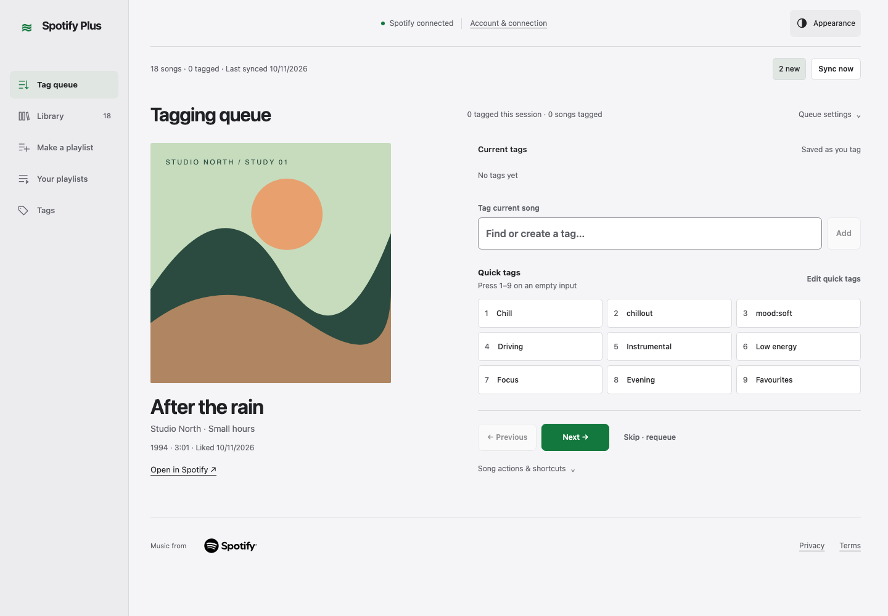 | 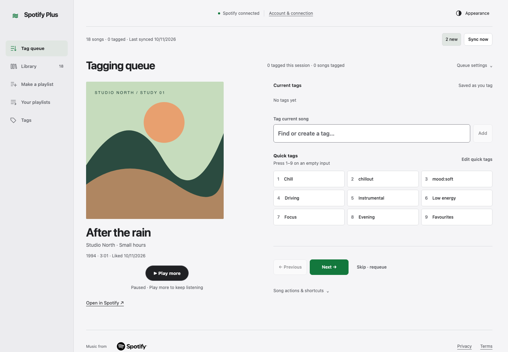 |

### Play → sample → Play more

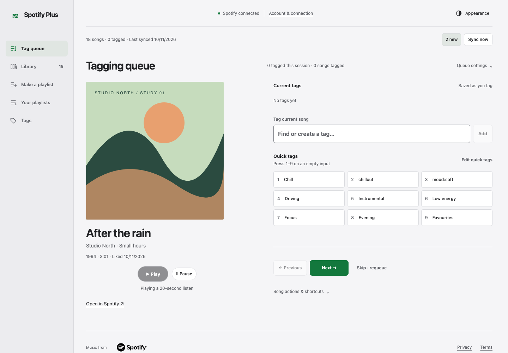

## Desktop · dark

Matched viewport: 1440 × 1000. Before offers Open in Spotify; after adds optional listening while preserving tags and navigation.

| Before | After the 20-second sample |
| --- | --- |
| 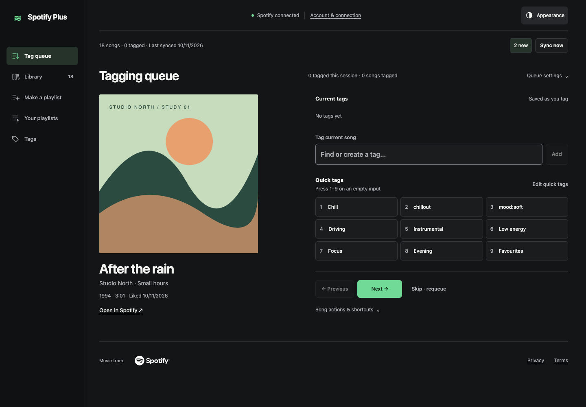 | 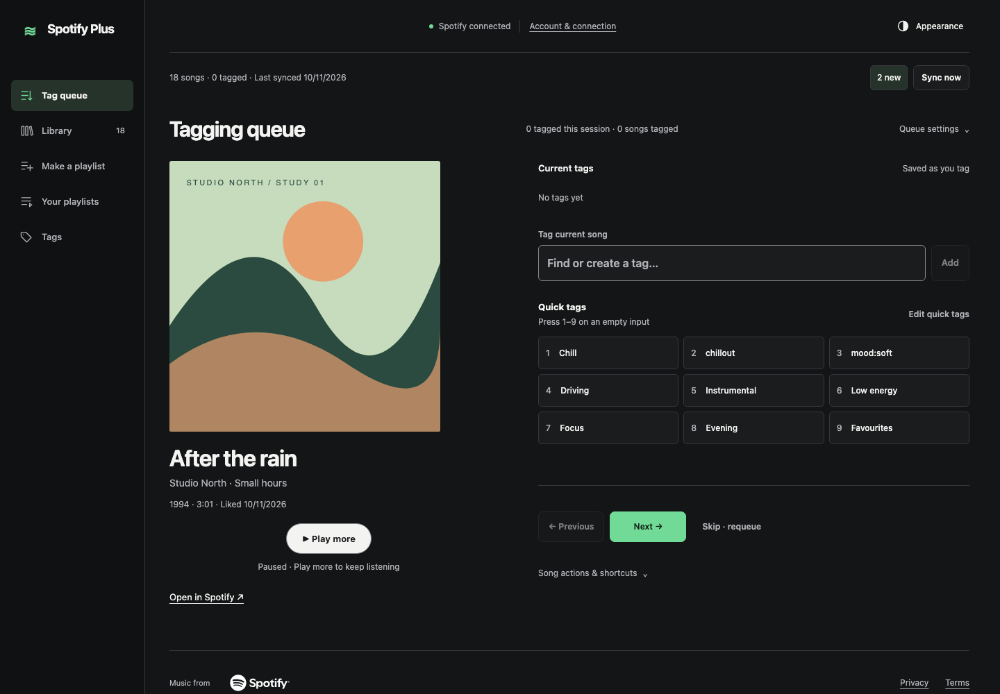 |

### Play → sample → Play more

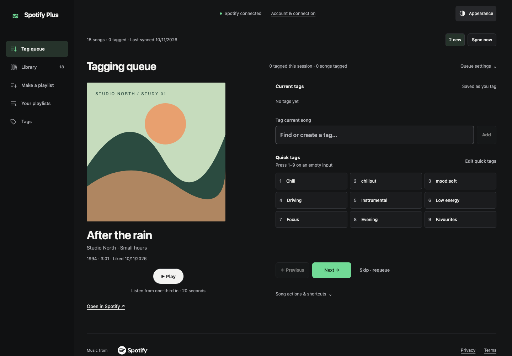

## Phone · light

Matched viewport: 390 × 844. Before offers Open in Spotify; after adds optional listening while preserving tags and navigation.

| Before | After the 20-second sample |
| --- | --- |
| 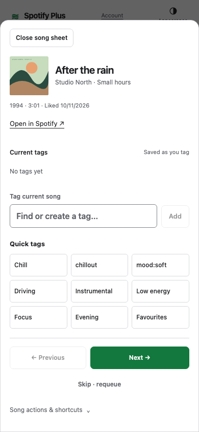 | 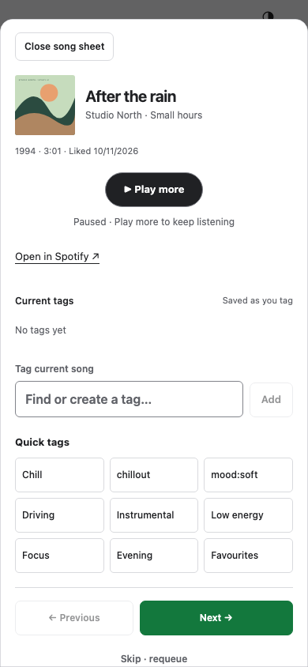 |

### Play → sample → Play more

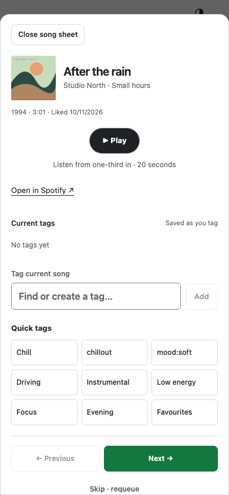

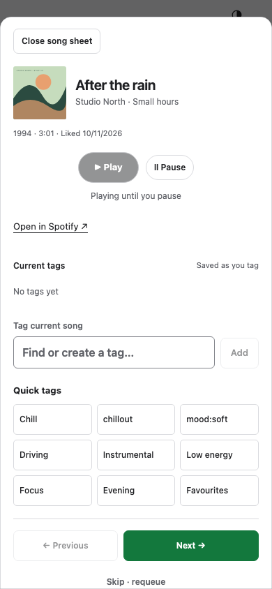

## Phone · dark

Matched viewport: 390 × 844. Before offers Open in Spotify; after adds optional listening while preserving tags and navigation.

| Before | After the 20-second sample |
| --- | --- |
| 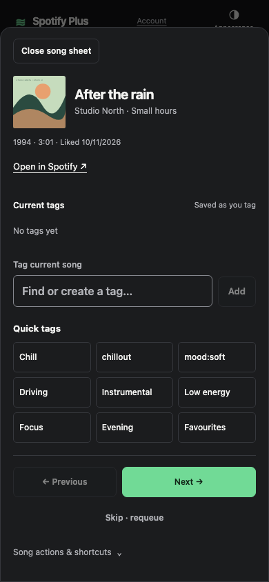 | 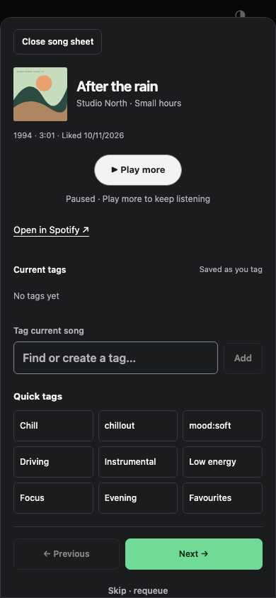 |

### Play → sample → Play more

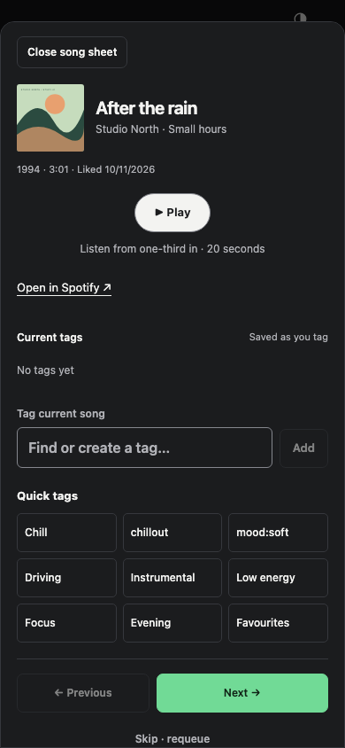

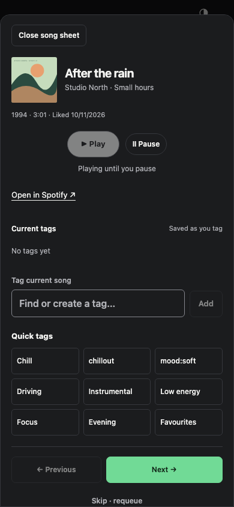
