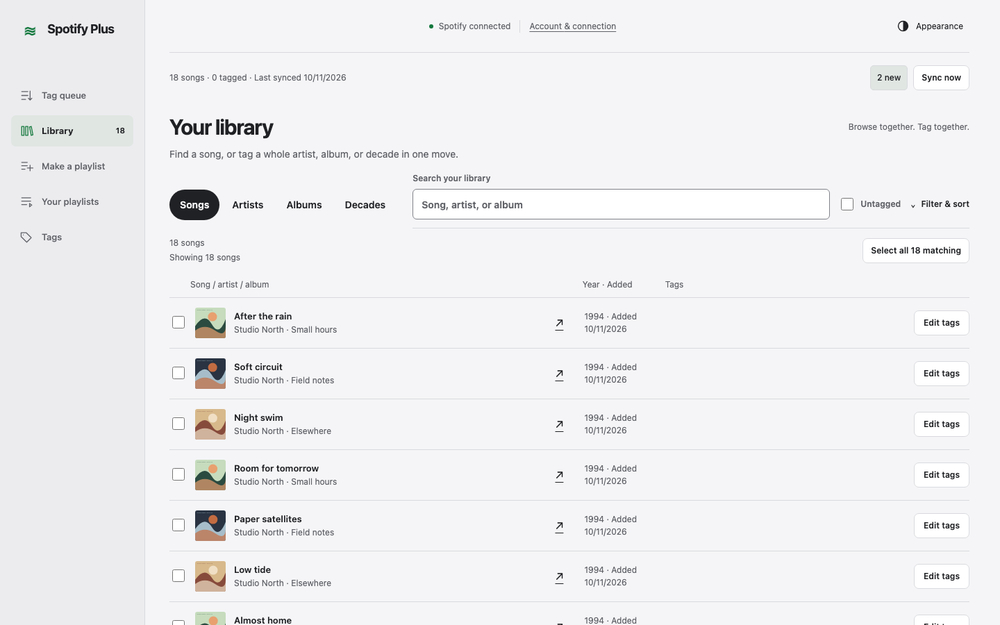
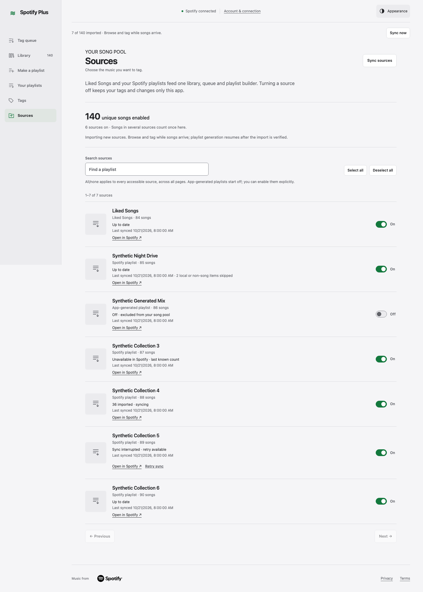
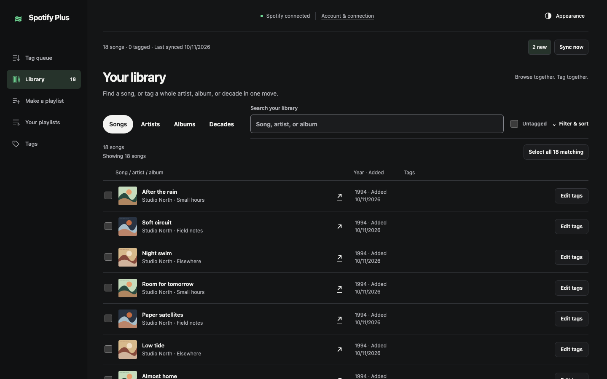
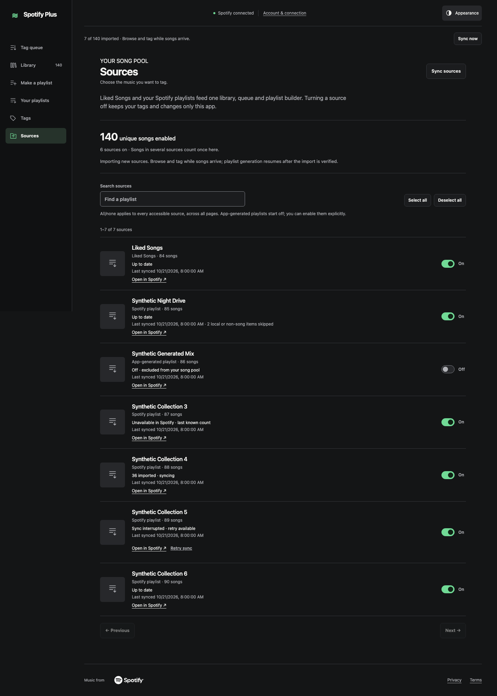
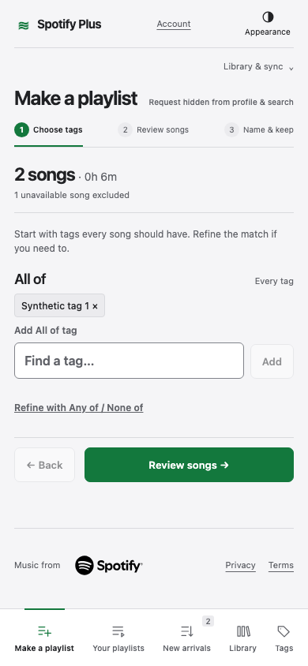
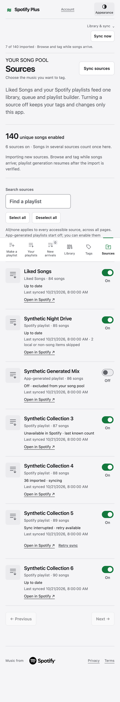
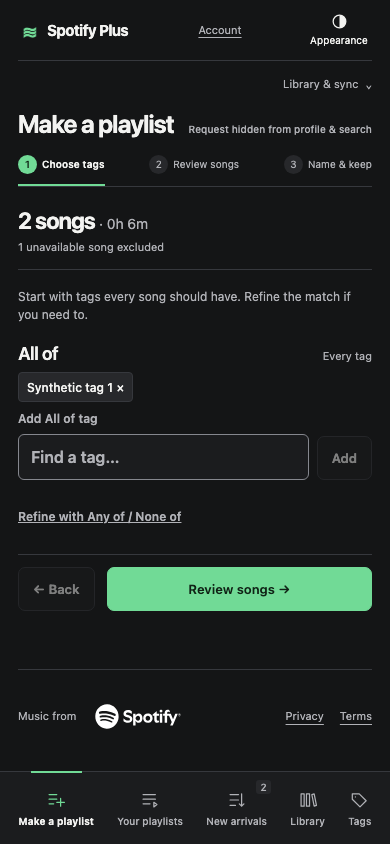
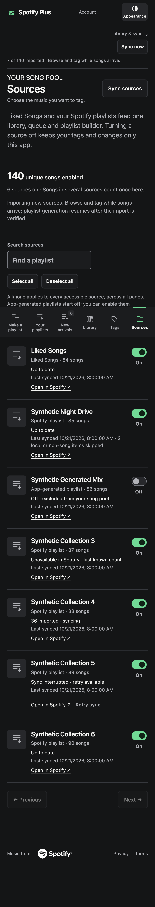

# Sources: synthetic visual proof

Sources adds a way to choose the app's song pool. The historical desktop Library and phone builder show the prior workspace entry points; the new Sources page shows the additional navigation, source switches and import states. **Sources did not exist before, so these are historical context and new-capability comparisons, not matched screenshots of the same view or dataset.**

The historical files are extracted byte-for-byte from `docs/design/guided-proof/original-captures.zip`, source `c3af630d95c485289898057fb4ffa68f6c43021f`. Its capture manifest records synthetic fixtures and blocked nonlocal traffic. The [manifest here](manifest.json) records the original archive entries, hashes and viewports. Desktop uses 1440 × 900; phone uses 390 × 844. Full-page captures include content below the viewport; fixed phone navigation appears at its original viewport position.

New captures use app source `c91ac94dd026c479c55aa2ccab972195ed9ed92d`, app tree `095f6b43edee219244146136d9091670afe3a699`, and the committed `tests/browser/sources.spec.ts` synthetic fixture. The fixture invents every collection name and count, blocks all nonlocal requests, and provides no real Spotify metadata or artwork. Missing artwork deliberately uses the established fallback. The seven-row example includes overlapping memberships, app-generated Off, an unavailable source, an import in progress, skipped local/non-song items and retryable failure.

The total is **140 unique enabled songs** even though individual collection counts overlap. On/Off switches state the app-pool choice; the copy explains that toggles preserve tags and change only this app. All/none explicitly applies across bounded server pages. Separate behavioral tests cover 53 sources, search, explicit generated-playlist opt-in, failed and late requests, optional collaborative consent, cross-client source selection, selection invalidation and playback cancellation.

## Desktop · light

| Historical Library entry                                              | New Sources capability                                       |
| --------------------------------------------------------------------- | ------------------------------------------------------------ |
|  |  |

## Desktop · dark

| Historical Library entry                                            | New Sources capability                                     |
| ------------------------------------------------------------------- | ---------------------------------------------------------- |
|  |  |

## Phone · light

| Historical phone builder entry                                             | New Sources capability                                         |
| -------------------------------------------------------------------------- | -------------------------------------------------------------- |
|  |  |

## Phone · dark

| Historical phone builder entry                                           | New Sources capability                                       |
| ------------------------------------------------------------------------ | ------------------------------------------------------------ |
|  |  |

Reproduce new captures from this worktree with Node 24 and the locked dependencies:

```sh
SOURCES_PROOF=1 npx playwright test tests/browser/sources.spec.ts --grep 'readable unavailable' --workers=2
```

These screenshots establish rendering with synthetic data. They do not establish live Spotify access, playlist visibility, source-import completeness, real audio or actual phone/tagging-speed acceptance. Integration, deployment and redacted live verification remain orchestrator gates.
